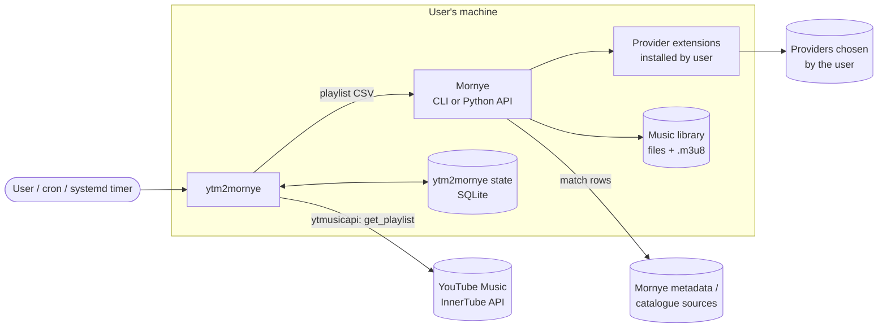
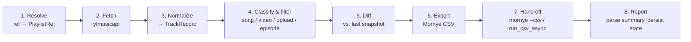
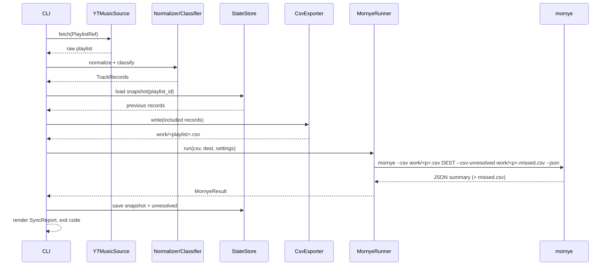

# ytm2mornye: Architecture Plan

This is the design for `ytm2mornye`. It is the source of truth for the first implementation. Anything marked **Decision** is settled for v1, and anything in [Open questions](#11-open-questions) is not.

Mornye details below come from the Mornye-Python docs and source (`mornye` 1.0.x: `docs/guide/*.md`, `application/download_engine.py`). Re-check them against the installed version before implementing.

---

## 1. Goals and non-goals

**Goals**

- G1. Take any YouTube Music playlist reference (URL, playlist ID, `LM` for Liked Music, album `OLAK5uy_…` IDs) and produce a local, tagged library through Mornye.
- G2. Prefer *correct* over *complete*. A track that can't be matched confidently gets reported, never guessed.
- G3. Make re-runs idempotent and incremental, so the tool is safe to run on a schedule.
- G4. Keep a thin layer over Mornye. Matching, downloading, tagging, lyrics, M3U writing, and provider fallback stay in Mornye.
- G5. Be scriptable: stable CLI, `--json` output, meaningful exit codes.

**Non-goals**

- No bundled, recommended, or default download providers or registries. Configuring those is the user's job inside Mornye.
- No re-implementation of audio matching or tagging that Mornye already does.
- No GUI (Mornye already has `--gui`, `--web`, `--tui`).
- No write-back to YouTube Music (no creating or editing playlists).
- No automatic deletion of local files when tracks leave a playlist.

## 2. Context



**Trust boundaries**

- YouTube Music responses are untrusted input. Sanitize titles before they reach file names or CSV cells.
- Mornye extensions run code the user chose to install. `ytm2mornye` never installs or picks one.
- YouTube Music auth material (browser headers) is a secret. It lives outside the repo and is never logged.

## 3. Pipeline

The tool is a linear pipeline. Each stage has typed input and output, so each one can be tested on its own.



| # | Stage | Input → Output | Notes |
| --- | --- | --- | --- |
| 1 | **Resolve** | `str` → `PlaylistRef` | Accepts `music.youtube.com/playlist?list=…`, `youtube.com/playlist?list=…`, bare IDs, `LM`, and `OLAK5uy_…`. Strips `si=` and other tracking params. Rejects watch URLs that have no `list=`. |
| 2 | **Fetch** | `PlaylistRef` → raw `dict` | `YTMusic().get_playlist(id, limit=None)` pages through the whole playlist. Album IDs go through `get_album_browse_id` → `get_album`. Anonymous client for public playlists, authenticated client for private ones and `LM`. |
| 3 | **Normalize** | raw → `Playlist` + `list[TrackRecord]` | Maps ytmusicapi fields onto the data model (§4). Joins multiple artists, keeps the primary artist separately, and converts `duration_seconds` to ms. |
| 4 | **Classify & filter** | `TrackRecord` → `TrackRecord` (+ `kind`, `skip_reason`) | Uses `videoType`: `MUSIC_VIDEO_TYPE_ATV` → `song`, `…_OMV` → `official_video`, `…_UGC` → `user_upload`, `…_PODCAST_EPISODE` → `episode`. Also drops `isAvailable == False`. Applies the `include` policy and cleans titles (§5). |
| 5 | **Diff** | records + previous snapshot → `PlaylistDiff` | Track identity is `videoId` (and `setVideoId` for duplicates). Produces `added`, `removed`, `unchanged`, `previously_unresolved`. |
| 6 | **Export** | records → CSV file | Writes the format Mornye's `--csv` reader recognizes (§6). One file per playlist, in a per-run work dir. |
| 7 | **Hand off** | CSV + `MornyeSettings` → Mornye run summary | Through the `MornyeRunner` port (§8). Default adapter runs the `mornye` CLI with `--json`. |
| 8 | **Report** | summary + diff → `SyncReport` | Records matched, downloaded, skipped (already present), and unresolved tracks. Saves the new snapshot and prints a human or JSON report. Sets the exit code. |

### Sequence: `ytm2mornye sync <ref> --dest ~/Music`



**Decision: hand the whole playlist to Mornye on every run, not just the diff.** Mornye already skips files that exist in the destination, de-duplicates tracks, and rewrites the M3U only when it changes. Passing the full list keeps the M3U complete and the order correct. The diff is used for reporting and for re-trying earlier misses, not to cut down the download set.

## 4. Data model

```text
PlaylistRef
  id: str                     # "PL…", "LM", "OLAK5uy_…", "VL…" stripped
  kind: playlist | liked | album
  requires_auth: bool

Playlist
  id, title, author, track_count, fetched_at

TrackRecord
  video_id: str               # stable YT identity
  set_video_id: str | None    # distinguishes duplicate entries in a playlist
  position: int               # 1-based order in the playlist
  title: str                  # cleaned (see §5)
  raw_title: str              # as returned by YT Music
  artists: list[str]
  album: str | None
  duration_ms: int | None
  kind: song | official_video | user_upload | episode | unknown
  available: bool
  explicit: bool | None
  skip_reason: str | None     # "unavailable", "filtered:user_upload", …

MornyeSettings               # forwarded verbatim; ytm2mornye doesn't interpret them
  services, quality, allow_fallback, filename_format, m3u,
  min_score, max_concurrent, profile, extra_args

SyncReport
  playlist, diff, matched, downloaded, already_present,
  unresolved: list[TrackRecord + reason], skipped: list[TrackRecord], exit_code
```

YouTube Music usually has **no ISRC**, so `match` mode relies on title + artist + album + duration. Duration matters because Mornye penalizes candidates more than ~7 s off, which catches extended mixes and live versions.

## 5. Matching-quality strategy

Mornye does the matching. `ytm2mornye`'s job is to give it the cleanest possible input.

- **Title cleanup** (only on `official_video` and `user_upload`; `song` titles are already clean): strip suffixes such as `(Official Video)`, `(Official Music Video)`, `[Lyric Video]`, `(Visualizer)`, `(Audio)`, `| Topic`, `HD`/`4K`. Keep musically meaningful parentheticals: `(Remix)`, `(Live)`, `(Acoustic)`, `(feat. …)`, `(… Version)`.
- **Artist cleanup:** drop the ` - Topic` channel suffix. For uploads where the title is `Artist - Title` and the "artist" is just a channel name, split on the first ` - `.
- **Duration:** pass `duration_ms` only for `song` and `official_video`. A music video's running time often includes intros and outros, so this stays configurable: `video_duration = "send" | "omit"`, default `omit`.
- **Default include policy:** `["song", "official_video"]`. User uploads are reported as skipped unless the user opts in, because they are the most common source of wrong matches.
- **Threshold:** forward `min_score` to `--csv-min-score`. Default to Mornye's own default (0.62) and don't second-guess it.

## 6. Mornye integration contract

### 6.1 CSV produced by `ytm2mornye` (`match` mode)

The header names are chosen to match the column aliases Mornye's CSV reader already recognizes:

```csv
Title,Artist,Album,Duration (ms)
"Everlong","Foo Fighters","The Colour and the Shape","250000"
```

- UTF-8, comma-delimited, RFC 4180 quoting. Multiple artists are joined with `, `.
- Rows are written in playlist order, because Mornye writes the M3U in file order.
- There's **no link column** in `match` mode on purpose. A `music.youtube.com` link would send the row down Mornye's YouTube-provider path instead of catalogue matching.
- The file is named after the playlist title (sanitized), since Mornye names the M3U after the CSV file.

### 6.2 `direct` mode

`direct` mode skips the CSV and passes `music.youtube.com/playlist?list=…` (or one `watch?v=` URL per track) to Mornye. This needs a YouTube provider extension, which `ytm2mornye` checks for before starting. Audio is whatever that provider serves, usually lossy. The point of this mode is completeness (live sets, uploads, regional exclusives) at the cost of quality.

### 6.3 Invocation

Default adapter (`MornyeCliRunner`), run as a subprocess with an argument list, never a shell string:

```bash
mornye --csv <work>/<Playlist>.csv <DEST> \
  --csv-unresolved <work>/<Playlist>.missed.csv \
  --csv-min-score <min_score> \
  --service <s1> --service <s2> --quality <q> \
  --m3u <fmt> --max-concurrent <n> [--profile <name>] --json
```

Alternative adapter (`MornyeLibraryRunner`) for long-running or async use:

```python
from mornye.downloader import DownloadOptions, MornyeDownloader
summary = await MornyeDownloader(DownloadOptions(output_dir=dest, ...)).run_csv_async(
    csv_path, min_score=min_score, m3u_format=m3u, name=playlist.title,
)
```

`plan` maps onto `mornye --csv <file> --csv-dry-run --json`, so no audio is fetched.

**Decision: the CLI adapter is the default.** It isolates `ytm2mornye` from Mornye's internal Python API, which is less documented and moves faster than the CLI flags. It also keeps a misbehaving extension out of our process, and it inherits the user's Mornye configuration and profiles exactly. The library adapter is an optional extra.

### 6.4 Preconditions checked by `ytm2mornye doctor`

- `mornye` is on `PATH` (or importable) and its version is inside the supported range.
- At least one registry is configured (`MORNYE_REGISTRIES` or `~/.mornye/registry_settings.json`) and at least one provider extension is installed. Otherwise Mornye can only resolve metadata. `doctor` explains this and does not suggest any specific registry.
- In `direct` mode, a YouTube provider is installed.
- The destination is writable, and `ffmpeg` is present if `transcode_to` is set.

## 7. Planned module layout

These files aren't in the repo yet. This is the target structure.

```text
src/ytm2mornye/
├── __init__.py
├── __main__.py            # python -m ytm2mornye
├── cli.py                 # Typer/argparse commands: sync, plan, export, watch, auth, doctor
├── config.py              # TOML + env + CLI flag merge → Settings (pydantic or dataclasses)
├── models.py              # PlaylistRef, Playlist, TrackRecord, SyncReport, …
├── refs.py                # stage 1: URL/ID parsing
├── sources/
│   ├── base.py            # PlaylistSource protocol
│   └── ytmusic.py         # stage 2: ytmusicapi adapter, auth handling, paging, retries
├── normalize.py           # stage 3
├── classify.py            # stage 4: video-type mapping, include policy, title/artist cleanup
├── state.py               # stage 5: SQLite snapshot store + diff
├── export_csv.py          # stage 6
├── runners/
│   ├── base.py            # MornyeRunner protocol
│   ├── cli_runner.py      # stage 7 default
│   └── lib_runner.py      # stage 7 optional (extra: ytm2mornye[lib])
├── report.py              # stage 8: human + JSON rendering, exit codes
└── watch.py               # interval loop with jitter, lock file

tests/
├── fixtures/              # recorded ytmusicapi responses (sanitized), sample Mornye JSON
├── test_refs.py
├── test_normalize.py
├── test_classify.py
├── test_state.py
├── test_export_csv.py
├── test_cli_runner.py     # subprocess mocked; asserts exact argv
└── test_e2e_dry_run.py    # optional, marked; needs real mornye, uses --csv-dry-run
```

Packaging: `pyproject.toml` (hatchling or setuptools), console script `ytm2mornye`, `requires-python >= 3.11`. Runtime deps: `ytmusicapi`, `platformdirs`, `tomli-w` (writes only; reads use stdlib `tomllib`). `mornye` is a dependency only of the `[lib]` extra. The CLI adapter just needs it on `PATH`.

## 8. Ports and adapters

The two external systems sit behind small protocols, so the core can be tested without the network:

```python
class PlaylistSource(Protocol):
    def fetch(self, ref: PlaylistRef) -> RawPlaylist: ...

class MornyeRunner(Protocol):
    def check(self) -> DoctorResult: ...
    def plan(self, csv: Path, settings: MornyeSettings) -> MornyeResult: ...
    def run(self, csv: Path, dest: Path, settings: MornyeSettings) -> MornyeResult: ...
```

Adding a second source later (a local YT Music Takeout export, for example) means writing one new `PlaylistSource` and nothing else.

## 9. State, config, and secrets

| What | Where (via `platformdirs`) | Notes |
| --- | --- | --- |
| Config | `~/.config/ytm2mornye/config.toml` | Precedence: CLI flags > env (`YTM2MORNYE_*`) > config file > defaults |
| YT Music auth | `~/.config/ytm2mornye/browser.json` | Created by `ytm2mornye auth setup` (wraps `ytmusicapi browser`). File mode `0600`. Never logged or echoed. |
| State DB | `~/.local/state/ytm2mornye/state.sqlite` | Tables: `playlists(id, title, last_synced_at)`, `snapshots(playlist_id, video_id, set_video_id, position, title, artists, kind)`, `unresolved(playlist_id, video_id, reason, first_seen, last_seen)` |
| Work dir | `~/.cache/ytm2mornye/runs/<timestamp>/` | Generated CSVs, missed CSVs, raw Mornye JSON. The last N runs are kept for debugging. |
| Lock | `~/.local/state/ytm2mornye/<playlist_id>.lock` | Stops overlapping `watch`/cron runs from fighting over the same destination |

**Decision: browser-header auth, not OAuth, for v1.** Recent ytmusicapi versions require the user to bring their own Google Cloud OAuth client, which is a lot of setup for a personal tool. Browser headers work immediately for `LM` and private playlists. OAuth can come later behind the same `auth` command.

## 10. Errors and exit codes

| Code | Meaning |
| --- | --- |
| `0` | Every included track is on disk (downloaded or already present) |
| `1` | Completed, but some tracks were unresolved or failed in Mornye (listed in the report and the `missed.csv`) |
| `2` | Usage or config error (bad ref, invalid config) |
| `3` | YouTube Music error (playlist not found, private without auth, auth expired, rate limited after retries) |
| `4` | Mornye precondition failed (not installed, no provider, unsupported version) |
| `5` | Mornye crashed or returned unparseable output |

- Network calls to YouTube Music retry with exponential backoff and jitter (max 5 tries) on 429/5xx. Auth errors don't retry.
- A failed Mornye run still saves the snapshot of what was *fetched*, so the next run's diff stays accurate.
- `watch` never exits on a code `1` or `3`. It logs, backs off, and tries the next cycle. It does exit on `2` or `4`.

## 11. Open questions

1. **Version coupling.** How tightly should the `mornye` version be pinned? The plan is to test against a range in CI and fail `doctor` outside it.
2. **Native YT Music in Mornye.** If Mornye's core gains YT Music playlist resolution, `ytm2mornye` could become a thin pre-filter, or be retired. The ports in §8 keep that cheap.
3. **Removed tracks.** Offer an opt-in `--prune` that moves, never deletes, files for tracks removed from the playlist into a `_removed/` folder? Deferred: mapping a file back to a track needs Mornye's download log.
4. **ISRC enrichment.** Should an optional pre-pass look up ISRCs (MusicBrainz, for example) to give Mornye an exact match key? This costs extra requests and rate limits, so it would be opt-in.
5. **Multi-playlist runs.** Mornye's `--playlist` flag groups playlists into one folder with an M3U each. Check whether running one CSV per playlist into a shared `--dest` behaves the same, or whether we need to use that flag.

## 12. Roadmap

| Milestone | Scope | Done when |
| --- | --- | --- |
| **M0: Blueprint** | This document + README | Reviewed |
| **M1: Export only** | `refs`, `sources/ytmusic` (anonymous), `normalize`, `classify`, `export_csv`, `ytm2mornye export` | A public playlist exports to a CSV that `mornye --csv … --csv-dry-run` accepts, with ≥ 90% of `song` rows resolved on a sample playlist |
| **M2: Sync** | `runners/cli_runner`, `report`, `sync`, `plan`, `doctor`, exit codes | `sync` on a sample playlist produces files + M3U, and a re-run downloads nothing |
| **M3: State & incremental** | `state.py`, diff reporting, unresolved tracking, retrying earlier misses | The report shows added/removed since the last run, and fixed rows in `missed.csv` can be fed back in |
| **M4: Auth & watch** | `auth setup`, `LM`/private playlists, `watch` with lock + backoff | Liked Music syncs on an interval without overlapping runs |
| **M5: Polish** | `direct` mode, `[lib]` runner, `--json` schema doc, packaging to PyPI, CI matrix (3.11–3.13) | Released as `0.1.0` |

## 13. Testing strategy

- **Unit tests** for each stage on recorded, sanitized ytmusicapi fixtures: songs, music videos, uploads, episodes, unavailable entries, duplicates, non-Latin titles, and 1000+ track playlists.
- **Contract tests** for the CSV: snapshot the exact bytes, plus a test that runs Mornye's own CSV reader (`mornye.core.csv_source.read_rows`) on our output when `mornye` is installed.
- **Runner tests** assert the exact `argv` and parse recorded `--json` outputs. There's no real subprocess in the default test run.
- **Optional end-to-end test** (marked, off in CI by default): real `ytmusicapi` against a public playlist plus `mornye --csv-dry-run`. It never downloads audio.
- **Lint and types:** `ruff`, `mypy --strict` on `src/`.
